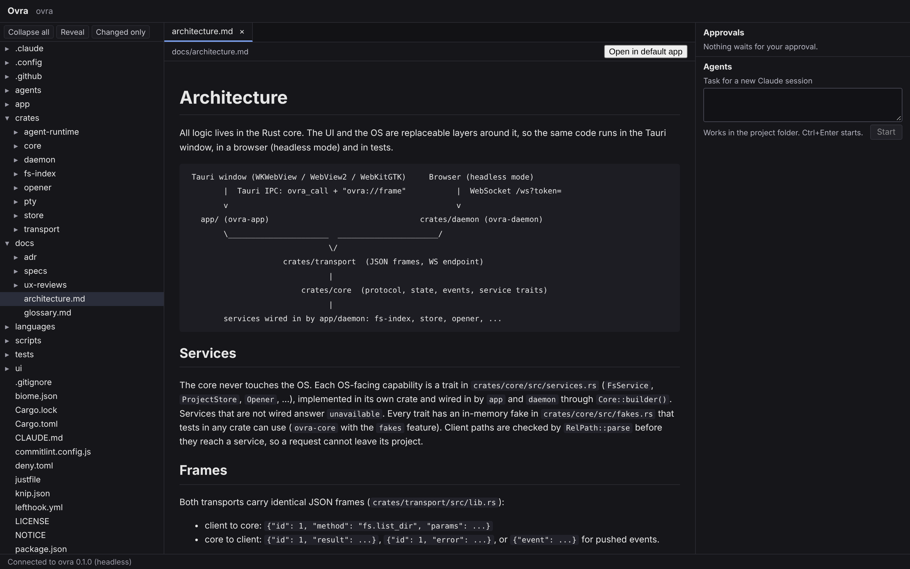

# Ovra

A lightweight, agent-first IDE. Agents do the work in isolated git worktrees;
people set tasks, watch progress and approve results. Rust core, Tauri 2 shell,
Svelte 5 UI, and a headless mode that runs the same UI in a regular browser.



**Website and docs:** https://shelenhovskyi.github.io/ovra/

## Status

Pre-alpha. Nothing is stable, there are no releases yet, and it is not ready
for daily work. Try it, break it and tell us what you think.

| Phase | What                                                       | State              |
| ----- | ---------------------------------------------------------- | ------------------ |
| 0     | Scaffold: core, headless mode, CI on Linux, macOS, Windows | done               |
| 1     | File tree, viewers, editor, terminal                       | working, polishing |
| 2     | Agents: Claude sessions, approvals, notifications          | in progress        |
| 3     | Orchestration: parallel agents, worktrees, review          | in progress        |
| 4     | Security: sandboxed agents, network policy                 | planned            |
| 5     | Windows polish and first release                           | planned            |
| 6     | Public extensions                                          | planned            |

## Try it

You need Rust, Node.js 22, pnpm, [`just`](https://just.systems) and the
[Tauri prerequisites](https://v2.tauri.app/start/prerequisites/). On Ubuntu,
`scripts/cloud-setup.sh` installs everything.

```sh
pnpm install
just dev-headless        # core + UI in a browser: open the printed OVRA_URL
just dev                 # desktop app
just test                # unit tests
just e2e                 # Playwright against headless mode
```

Agent sessions use your own installed [Claude Code](https://claude.com/claude-code)
CLI, signed in with your own account.

## How Ovra is built

Ovra is an IDE for working with agents, and it is built the same way. Most of
the code, tests and docs are written by Claude agents working in parallel,
each in its own git worktree. One human maintainer sets the tasks, makes the
architecture decisions, reviews the results and is responsible for what lands.
Agent commits are authored by Claude, so the history shows exactly that.

The process is public: the agents' rules in [`CLAUDE.md`](CLAUDE.md), the
decisions in [`docs/adr/`](docs/adr/), the agent roles in
[`.claude/agents/`](.claude/agents/) and UX reviews by persona agents in
[`docs/ux-reviews/`](docs/ux-reviews/). Every change passes the same automated
gates: tests with time budgets, end-to-end tests, a speed gate on a 100k-file
repository, lints, license and architecture checks. More in
[AI_POLICY.md](AI_POLICY.md).

## Privacy

No telemetry, no accounts, no Ovra servers. AI requests go from your own
`claude` CLI to Anthropic under your account. Any future telemetry will be
opt-in. Details in [PRIVACY.md](PRIVACY.md).

## Contributing

Bug reports, fixes and docs are welcome; please discuss features first in
[Discussions](https://github.com/shelenhovskyi/ovra/discussions). See
[CONTRIBUTING.md](CONTRIBUTING.md), the [Code of Conduct](CODE_OF_CONDUCT.md)
and [GOVERNANCE.md](GOVERNANCE.md). Report vulnerabilities privately as
described in [SECURITY.md](SECURITY.md).

## License

Apache License 2.0: see [LICENSE](LICENSE) and [NOTICE](NOTICE).
